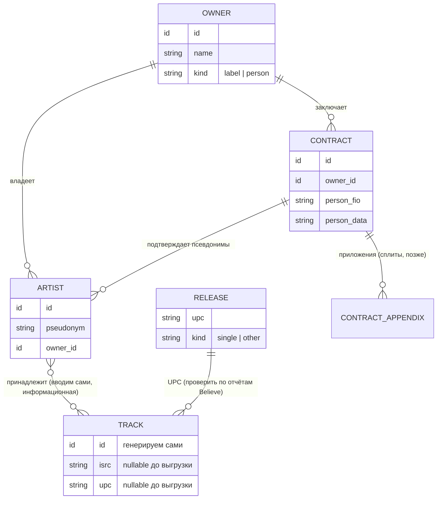

# Модуль 1: владение треком

Статус: принято 2026-10-29 (кроме пунктов из [99_открытые_вопросы.md](99_открытые_вопросы.md)).

## Схема

## Сущности

| Сущность | Суть |
|---|---|
| **Владелец** | Лейбл или человек. Получатель отчислений по принадлежащим ему артистам. |
| **Артист** | Псевдоним. Принадлежит одному владельцу. У владельца их может быть несколько. MC — такой же артист. |
| **Трек** | Ключевая сущность. Внутренний id генерируем сами. Уникальна **пара ISRC + UPC**: один ISRC в сингле и в альбоме — разные записи с разными UPC. До выгрузки ISRC (и UPC) может быть пустым и дописывается позже. |
| **Релиз** | Идентифицируется по UPC. Сингл и не-сингл. |
| **Договор** | Заключается с владельцем (лейблом). Основа: конкретный человек (ФИО, данные) и его псевдонимы (может быть несколько, все привязываются к одному человеку). Приложения: сплиты (позже). |
| **Документ** | Отдельная сущность: ссылка на файл договора, его uuid, срок на загрузку (`expiredTime`: время, за которое нужно загрузить документ; название поля под вопросом). Договор и приложения ссылаются на документ; на ту же таблицу ссылаются и другие модули (взаиморасчёты, выплаты). Есть признак «требует проверки менеджером» и статус (не прикреплён, не одобрен, одобрен). Технические детали позже. |

## Примеры

**Один человек — два владельца.** Витя Ак: по части треков отчисления идут Газгольдеру, по части — лично Вите. Создаются две записи артиста «Витя Ак» с разными владельцами, каждая владеет своими треками.

| Владелец | Артист | Трек (ISRC) |
|---|---|---|
| Вася Вакуленко | Ноггано | «Тем, кто с нами» |
| Вася Вакуленко | Баста | «Застрахуй» |
| Газгольдер | Витя Ак | «Азино 777 Remix» |

## Флоу создания

1. Есть договор: ФИО и данные человека, список псевдонимов → создаются артисты, привязанные к одному человеку.
2. Список треков иногда известен до выгрузки → создаём треки без ISRC, ISRC дописываем позже.
3. Без договора можно создать любую сущность, но она помечается как незакрытая, пока договор не подтверждён.
4. Если приходит сплит с артистом, которого в системе нет, создаётся запись артиста без владельца со статусом «ждёт документов» (раньше называли «пустышкой»; это полноценный артист, просто владелец ещё не подтверждён). Деньги ему начисляются. Владельца временно не назначаем (решено 2026-10-30). Когда придут документы, создаётся владелец, и к нему привязывается уже существующий артист, а нового не создаётся; если выяснится, что это дубль существующего артиста, записи объединяются (merge, [M12](98_межмодульные_вопросы.md)).

Владелец владеет многими артистами (это его псевдонимы), артист связан с многими треками, у каждого трека свой ISRC. Связь «артист — трек» хранится в модуле 1 и вводится нами вручную. Она информационная: показывает, к какому артисту принадлежит трек, чтобы не разбирать имена исполнителей из отчётов Believe. Деньги она не определяет: единственный источник правды о получателях это сплит по ISRC. (решено 2026-10-31)

## Документ как начало и проверка при выплате

Всё начинается с документа. Без него запись создать можно, но она помечается «без документа». Договор заключается с владельцем псевдонима; отдельного договора на артиста нет, артист подтверждается тем, что его псевдоним указан в договоре владельца. Решено 2026-10-30: выплата идёт владельцу, и у него должен быть подтверждающий документ (договор); у документа есть признак «требует проверки менеджером». Если владелец не подтверждён (нет документа или он не одобрен), выплата невозможна: это блокер на уровне владельца. Блокировок по артистам нет. Неподтверждёнными могут быть сплиты конкретных артистов (нет приложения к договору): они не учитываются в итоговом взаиморасчёте, а остальное, что владелец заработал по подтверждённым сплитам, выплачивается. Путь выплаты (реквизиты) проектируем позже, вопрос реализации ([M2](98_межмодульные_вопросы.md)).

## Похожие записи при вводе (дубли)

Когда приходит документ или создаётся запись, система может не знать, что такой человек или артист уже есть. Однофамильцы и одинаковые ники бывают на самом деле, поэтому автоматически не склеиваем.

- **Владелец / человек из документа.** Если в базе уже есть запись с таким ФИО, система предупреждает оператора и предлагает выбрать: «тот же» (привязать к существующему) или «добавить нового».
- **Артист.** Так же по псевдониму: оператору показываются существующие артисты с таким именем, он решает сам.
- **Что показывать оператору:** найденные похожие записи и признаки, по которым они совпали (ФИО, псевдоним, владелец, почта из договора, документы).
- **Открыто (идеи):** запоминать решение «это разные люди», чтобы не спрашивать повторно; какие признаки считать совпадением; как поступать при слиянии, если дубль обнаружен уже после создания.

Это отдельный блок взаимодействия оператора с модулем; та же логика нужна при разборе старых данных (см. сопоставление `cid` в обсуждении).

## Объединение записей (merge)

В модуле 1 нужна механика слияния. Случаи, когда она понадобится:
- автор или артист заведён без документов (пустышка «ждёт документов», например из паблишинга или из сплита) и позже выяснилось, что это уже существующий человек;
- артист без владельца (создан из сплита или из отчёта) получил документы: создаётся владелец, существующий артист привязывается к нему без создания нового; если это дубль уже существующего артиста, записи объединяются.
- дубль обнаружился уже после создания (однофамильцы разобрали неверно, одно и то же лицо под разным написанием);
- два владельца или два артиста оказались одной записью.

Принцип: оставшаяся запись «выживает», остальные ссылаются на неё. Так как расчёты ведутся с нуля, после слияния начисления, сплиты и корректировки автоматически собираются на нужной записи. Решение принимает оператор или менеджер, не система, и действие журналируется. Для владельца-пустышки (не подтверждён документом) направление известно: он сливается в оригинального, подтверждённого владельца, а идентификатор в паблишинге заменяется на оригинальный, чтобы начисления пошли ему (решено 2026-10-31).

Открыто: что именно переносится при слиянии (алиасы, договоры, документы, треки, сплиты, корректировки), можно ли откатить слияние, что делать, если у объединяемых записей разные владельцы или конфликтующие данные, и как это влияет на модули, где есть ссылки на `artist_id` ([98_межмодульные_вопросы.md](98_межмодульные_вопросы.md), M12).

## Валидация менеджерами

Новый релиз или новый артист попадает к менеджерам на валидацию: менеджер апрувит, когда документ появился, либо идёт и ищет документ. Это тоже работа оператора с модулем. Апрув переводит запись из «без документа» (незакрыта) в подтверждённую.

- **Что делает менеджер:** валидирует данные в договоре и то, что оператор ввёл (сверяет одно с другим). У оператора есть доступ к созданию записей, у менеджера — к просмотру и валидации. В целом будет набор прав доступа для разных людей (scope); пока записано на будущее, подробности не прорабатываем.
- **Что апрувится по договору:** владелец, артист и его треки (если они были указаны). Про треки вопрос открыт.
- **Очередь:** список записей, выбираемый из базы по статусу (технический вопрос, пока не решаем).
- **Срок на загрузку документа** (`expiredTime`) нужен: если документ не найден и создана заглушка, у неё есть время, за которое документ нужно загрузить. Что делать по истечении срока: ничего, либо обновить (продлить). Варианты на подумать.

Открыто: что именно апрувится помимо владельца и артиста (треки, релизы, сплиты) и что происходит по истечении срока.

## Статус «закрыто / незакрыто»

Сущность закрыта, когда подтверждена договором. Статус только помечает запись и ничего не блокирует сам по себе. Перед выплатой отдельный шаг проверяет, что с документами всё в порядке (следующий этап, см. [99_открытые_вопросы.md](99_открытые_вопросы.md)).

## Выплаты

Выплата привязана к владельцу. Таблицу реквизитов «куда платить» сейчас не проектируем (решено 2026-10-30); подразумевается, что владельцу можно платить на конкретный банковский счёт, карту и т.п., то есть это просто варианты вывода (банковский перевод, карта, PayPal). Детали проектируем позже вместе с выплатами.

## Роль артиста на треке

Роль `owner` / `feat` / `mc` на связи не нужна (решено 2026-10-30): получатели определяются сплитом.
