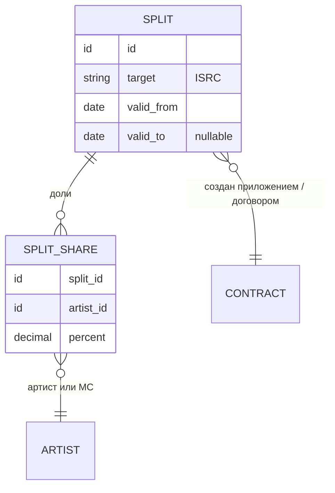

# Модуль сплитов

Статус: обсуждается, основа принята 2026-10-30. Решение о выделении: [ADR-003](решения/ADR-003-модуль-сплитов.md).

## Назначение

По ISRC ответить: какие артисты на треке (из [модуля 1](02_модель_данных.md), включая MC) и кому какая доля, включая нашу.

## Правила

1. **Хранятся доли артистов и MC** в абсолютных процентах от целого трека.
2. **Наша доля — остаток:** 100 минус сумма долей артистов и MC. Это то, что остаётся у нас на балансе. Договор (50/50, 60/40) определяет, сколько всего достаётся артистам, а доли внутри этой части задаются явно.
3. **Пример:** артисты и MC получают 20 / 15 / 15 (два артиста и один MC), нам остаётся 50.
3а. **Проверка при вводе:** сумма долей артистов и MC не больше 100 (иначе наша доля стала бы отрицательной, так в старых данных у 38 ISRC, см. [05_проблемы_в_данных.md](05_проблемы_в_данных.md), D1). Так же устроен текущий бэкофис (Backstage): вводятся доли артистов, остаток наш; жёсткой проверки «сумма равна пулу договора» там нет (уточнено 2026-10-30). Мягкая проверка с пулом из договора это опциональное улучшение.
4. **Уровень один: сплит на трек (по ISRC)** (решено 2026-10-30). Один трек, вышедший и синглом, и в альбоме, имеет один и тот же ISRC и один сплит, который считается от него. Сплита на релиз при расчёте нет. Базовый сплит артиста (по умолчанию 50/50) при расчёте тоже не используется: у трека доли всегда указаны явно. Базовый сплит и сплит «на весь релиз» допустимы только как заготовки при вводе: они подставляют значения в сплиты треков. Где хранится базовый сплит, см. открытые вопросы.
5. **Ключ:** сплит на трек привязан к **ISRC** (один для сингла и альбома). Разные версии трека (slowed, sped up и т.п.) — разные треки с разными ISRC, это нормально. Названия — справочная информация, на них не опираемся.
6. **Срок действия:** у сплита есть дата начала и необязательная дата окончания (нет конца = действует бессрочно). Периоды сплитов одного уровня и цели **не пересекаются**: изменение — это новый договор, предыдущий сплит закрывается до указанной даты, новый действует с неё.
7. **Какой сплит берём при расчёте:** по **дате отчёта**. Берётся сплит, в чей период попадает дата отчёта. Переход на дату продаж (sale date) возможен позже и глобально ничего не меняет.
8. **Любое создание или изменение сплита подтверждается договором.** Без договора запись «незакрыта». Сплит, не подтверждённый приложением к договору, участвует в расчётах, но в итоговую сводку и подсчёт сумм не входит и в выплату не идёт: эти деньги относятся к категории «ждут подтверждения» ([09_фасад.md](09_фасад.md), принцип 11; решено 2026-10-30).
9. **Договор и приложение.** Договор идёт в модуль 1 (человек и псевдонимы). Приложение идёт в модуль сплитов и создаёт сплит, если его ещё нет.
10. **Смена сплита и выкуп** (уточнено 2026-10-30). Выкуп — это смена сплита у конкретного артиста на ноль по перечисленным ISRC: доля продавца на этих треках становится 0, а наша доля как остаток растёт автоматически. Документ выкупа является подтверждением смены: без документа сплит менять нельзя. В текущей ERP выкуп хранится отдельной записью (`buyout`, `buyout_track` с долей продавца по каждому ISRC и месяцем действия) и применяется поверх сплита, в новой модели это просто сплит с нулевой долей продавца. Если доля продавца в договоре и в Backstage расходятся, действует договор.
11. **Типы договоров** пока не фиксируем: они могут быть разными (лицензионный, выкуп, деривативный и др.). Модель этого уровня не детализирует.
12. **Связь «артист — трек» в модуле 1 информационная (решено 2026-10-31).** Связь «артист — трек» хранится в модуле 1 и вводится нами вручную. Она информационная: показывает, к какому артисту принадлежит трек, чтобы не разбирать имена исполнителей из отчётов Believe. Деньги она не определяет: единственный источник правды о получателях это сплит по ISRC. Названия и исполнители в отчётах и заголовках метаинформация: на них не опираемся. Если в названии один артист, а в сплите два, платим по сплиту.
13. **Артист в сплите, которого нет в системе.** Если приходит сплит с неизвестным артистом, создаётся запись артиста без владельца со статусом «ждёт документов» (полноценный артист, не «пустышка»). Деньги ему начисляются; владельца временно не назначаем. Когда придут документы, создаётся владелец и к нему привязывается этот же артист, а если это дубль существующего артиста, записи объединяются (M12). Общее правило «незакрыто» действует (решено 2026-10-30).
14. **Проверки.** Артист в сплите должен существовать в модуле 1 (если нет, создаётся артист без владельца, правило 13). Сумма долей артистов и MC не больше 100 (правило 3а). Доля 0 допустима.
15. **ISRC без сплита на дату отчёта.** Доход по такому ISRC остаётся у нас (наша доля — остаток, артистов в сплите нет); это деньги, которые уже получены на баланс по отчётам Believe и паблишинга. Если сплит появится и будет действовать с даты, охватывающей этот отчёт, пересчёт с нуля перераспределит доход артистам (решено 2026-10-30).
16. **Получатели определяются только сплитами** (решено 2026-10-30). Сплит ведётся по ISRC; имена исполнителей и лейблов из отчёта источника не используются вообще, ключевое поле ISRC. Один ISRC в сингле и в альбоме имеет один сплит.

## Схема

Наша доля отдельно не хранится: она равна 100 минус сумма `percent` по `SPLIT_SHARE` одного `SPLIT`. Сумма `percent` не больше 100.

## Открытые вопросы модуля

1. (Закрыт 2026-10-30) Приоритета сплитов нет: уровень один, сплит на трек по ISRC (правило 4).
2. **Где хранится базовый сплит и как он подставляется.** Он нужен как заготовка при добавлении релиза или трека. Предположение: хранится у артиста в модуле 1, сплиты читают его при создании. Если на треке несколько артистов с разными базовыми (50/50 и 60/40), заготовка только предлагает значения, а итог указывает оператор, поэтому конфликт при расчёте не возникает. Остаётся решить: чьи значения предлагать по умолчанию.
3. **Пересчёт** задним числом вынесен в [98_межмодульные_вопросы.md](98_межмодульные_вопросы.md) (M7).
4. **Бывает ли ISRC без сплита на практике и нужен ли сигнал.** По данным (docs/исследование/результаты_2026-10-16.md, M2) в сплитах 14.08 не хватало 1 727 ISRC, около $61 тыс. net, в основном релизы после этой даты, то есть новые релизы приходят в отчётах раньше, чем заведён сплит. Нужно ли сигнализировать менеджерам, что у ISRC нет сплита, чтобы его завели, и как это отличать от намеренного «всё нам».
5. (Уточнено 2026-10-31) Связь «артист — трек» есть в модуле 1 как информационная и деньги не определяет. Открыто (необязательно): подсвечивать мягким предупреждением, если состав сплита расходится со связью.
6. **По какой дате действуют сплит и выкуп: дата отчёта или дата продаж** (вопрос к владельцу продукта, 2026-10-30). Временно считаем по дате отчёта (правило 7). Если взять дату продаж, то деньги, заработанные до даты выкупа, но пришедшие в отчёте после неё, нужно выплатить продавцу. Логику можно поменять, потому что в базе хранятся обе даты ([06](06_модуль_источников.md), решение 4). Масштаб по июльскому отчёту Believe 2026: 44,9% суммы это продажи того же месяца, 50,8% предыдущего, 4,3% за 2–3 месяца назад, остальное меньше 0,1%, то есть разница затрагивает в основном 1–3 месяца вокруг даты выкупа.
